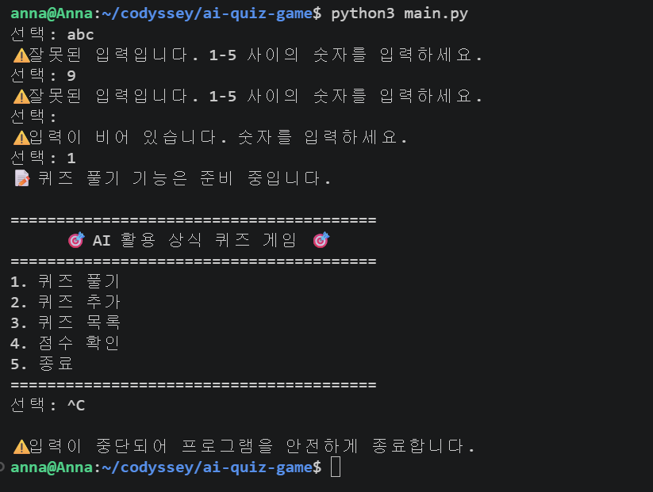
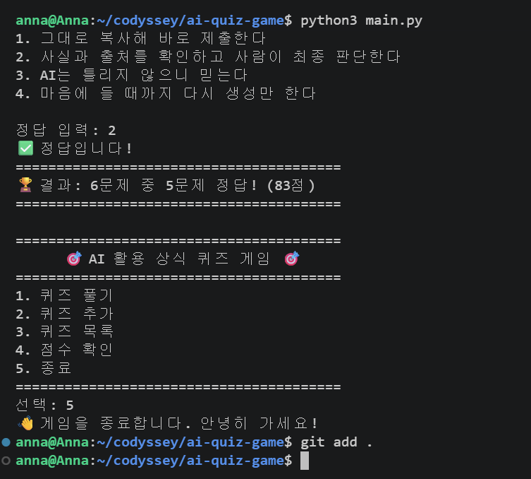
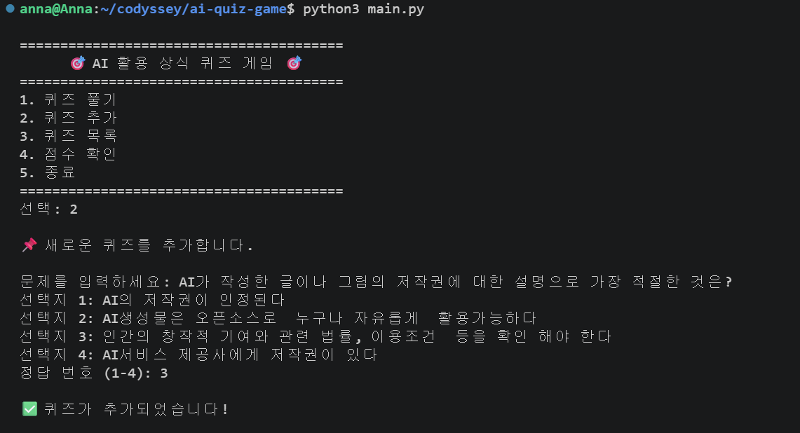
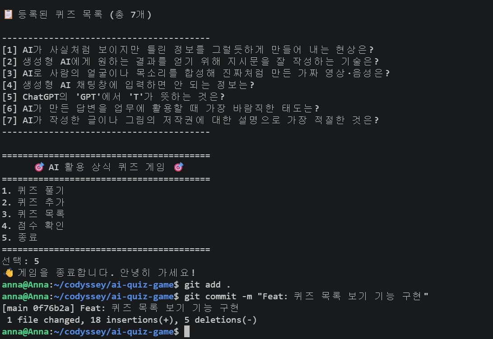
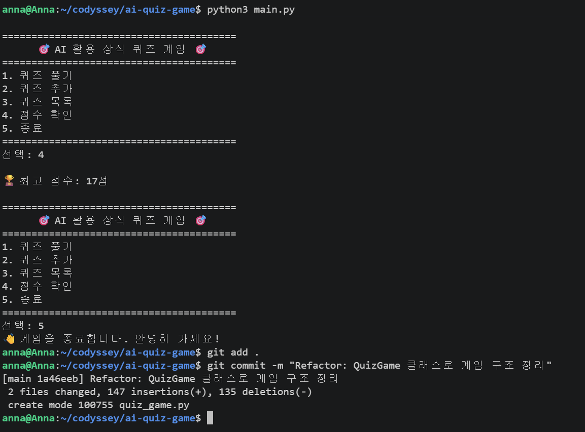
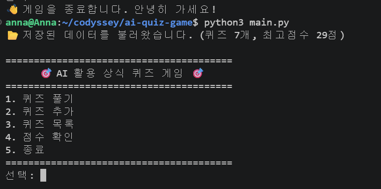
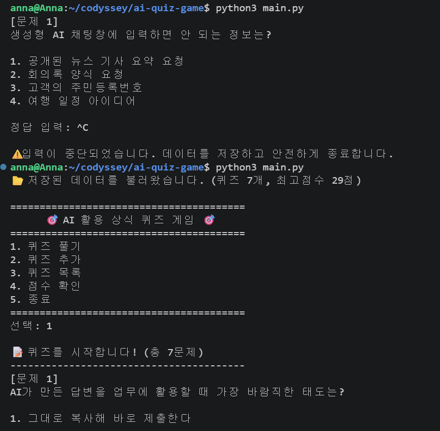
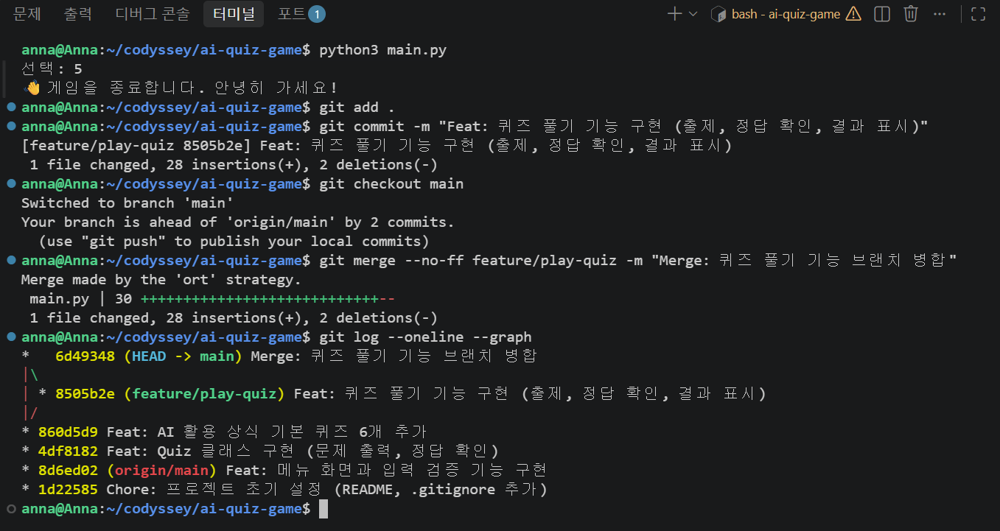

# AI 활용 상식 퀴즈 게임

AI 시대에 필요한 AI 활용 능력을 스스로 점검하기 위한 Python 콘솔 퀴즈 게임입니다.

## 1. 프로젝트 개요

- 터미널에서 실행하는 메뉴형 퀴즈 게임입니다.
- 퀴즈 풀기, 퀴즈 추가, 퀴즈 목록, 최고 점수 확인 기능이 있습니다.
- 추가한 퀴즈와 최고 점수는 `state.json` 파일에 저장되어, 프로그램을 다시 실행해도 유지됩니다.
- Python 표준 라이브러리(`json`, `random`, `pathlib`)만 사용하며, 외부 라이브러리는 사용하지 않습니다.

## 2. 퀴즈 주제와 선정 이유

- **주제:** AI 활용 상식
- **선정 이유:** AI 시대에 필요한 AI 활용 능력을 스스로 점검(자가점검)하기 위해서입니다.
- 할루시네이션, 프롬프트, 딥페이크, 개인정보 보호, AI 답변 검증 태도 등 AI를 안전하고 올바르게 쓰기 위한 기본 상식을 다룹니다.

## 3. 실행 방법

**실행 환경:** Python 3.10 이상 (개발 환경: WSL Ubuntu, Python 3.14.4)

```bash
git clone https://github.com/annafedulab-code/ai-quiz-game.git
cd ai-quiz-game
python3 main.py
```

- 메뉴에서 1~5 중 번호를 입력해 기능을 선택합니다.
- 실행 중 `Ctrl+C`를 누르면 데이터를 저장하고 안전하게 종료합니다.

## 4. 기능 목록

| 메뉴 | 기능 | 설명 |
|---|---|---|
| 1 | 퀴즈 풀기 | 등록된 퀴즈를 **무작위 순서**로 출제하고, 정답/오답과 최종 점수(100점 만점)를 보여 줍니다. |
| 2 | 퀴즈 추가 | 문제, 선택지 4개, 정답 번호(1~4)를 입력받아 새 퀴즈를 등록하고 파일에 저장합니다. |
| 3 | 퀴즈 목록 | 등록된 퀴즈의 문제 목록을 번호와 함께 보여 줍니다. |
| 4 | 점수 확인 | 최고 점수를 보여 줍니다. 아직 푼 기록이 없으면 안내 메시지를 보여 줍니다. |
| 5 | 종료 | 데이터를 저장하고 프로그램을 종료합니다. |

**입력/예외 처리**

- 입력 앞뒤 공백은 제거한 뒤 처리합니다.
- 빈 입력, 숫자가 아닌 입력(예: `abc`), 범위 밖 숫자(예: 메뉴 `9`, 정답 `0`)는 안내 메시지를 보여 주고 다시 입력받습니다.
- `Ctrl+C`(KeyboardInterrupt)와 입력 종료(EOFError)가 발생해도 비정상 종료하지 않고, 저장 후 안전하게 종료합니다.
- `state.json`이 없으면 기본 퀴즈로 시작하고, 손상되었으면 안내 메시지를 보여 준 뒤 기본 퀴즈 데이터로 복구합니다.

**보너스 기능**

- 랜덤 출제: `random.shuffle()`로 문제 순서를 섞습니다. 원본 목록은 그대로 두고 복사본만 섞어서, 퀴즈 목록 순서와 저장 파일은 바뀌지 않습니다.

## 5. 파일 구조

```
ai-quiz-game/
├── main.py             # 실행 파일: 게임을 시작하고 Ctrl+C/EOF를 안전하게 처리
├── quiz.py             # Quiz 클래스: 퀴즈 1문제 (문제 출력, 정답 확인, 저장용 변환)
├── quiz_game.py        # QuizGame 클래스: 메뉴, 입력 처리, 풀기/추가/목록/점수, 파일 저장/불러오기
├── default_quizzes.py  # 기본 퀴즈 6개 (Quiz 객체로 생성)
├── state.json          # 저장 데이터: 퀴즈 목록과 최고 점수 (실행 시 자동 생성/갱신)
├── docs/
│   └── screenshots/    # 실행 화면 캡처
├── .gitignore          # Git에 올리지 않을 파일 목록 (__pycache__ 등)
└── README.md
```

**클래스 구성**

| 클래스 | 역할 | 주요 속성 | 주요 메서드 |
|---|---|---|---|
| `Quiz` | 퀴즈 1문제 | `question`, `choices`, `answer` | `display()`, `is_correct()`, `to_dict()`, `from_dict()` |
| `QuizGame` | 게임 전체 관리 | `quizzes`, `best_score` | `run()`, `play_quiz()`, `add_quiz()`, `show_quiz_list()`, `show_best_score()`, `load_state()`, `save_state()` |

## 6. 데이터 파일 설명 (state.json)

- **경로:** 프로젝트 루트의 `state.json` (`quiz_game.py`와 같은 폴더)
- **역할:** 퀴즈 목록과 최고 점수를 저장해, 프로그램을 다시 실행해도 데이터가 유지되게 합니다.
- **인코딩:** UTF-8 (한글이 깨지지 않도록 `ensure_ascii=False`로 저장)
- **저장 시점:** 퀴즈를 추가할 때, 최고 점수가 바뀔 때, 프로그램을 종료할 때(`5` 또는 `Ctrl+C`)

**스키마(필드 구조)**

| 필드 | 형식 | 설명 |
|---|---|---|
| `quizzes` | list | 퀴즈 목록 |
| `quizzes[].question` | str | 문제 |
| `quizzes[].choices` | list (str 4개) | 선택지 4개 |
| `quizzes[].answer` | int (1~4) | 정답 번호 |
| `best_score` | int 또는 null | 최고 점수(0~100점). 아직 푼 기록이 없으면 `null` |

**예시**

```json
{
    "quizzes": [
        {
            "question": "AI가 사실처럼 보이지만 틀린 정보를 그럴듯하게 만들어 내는 현상은?",
            "choices": ["딥페이크", "할루시네이션", "클라우드", "버그"],
            "answer": 2
        }
    ],
    "best_score": 29
}
```

## 7. 실행 화면

| 화면 | 캡처 |
|---|---|
| 메뉴와 잘못된 입력 처리 |  |
| 퀴즈 풀기 |  |
| 퀴즈 추가 |  |
| 퀴즈 목록 |  |
| 점수 확인 |  |
| 재실행 후 데이터 유지 |  |
| 랜덤 출제 (보너스) |  |

## 8. Git 작업 기록

- 기능 단위로 커밋했습니다. (메뉴 → Quiz 클래스 → 기본 데이터 → 퀴즈 풀기 → 추가 → 목록 → 점수 → QuizGame 정리 → 파일 저장 → 랜덤 출제 → README)
- `feature/play-quiz` 브랜치를 만들어 퀴즈 풀기 기능을 개발한 뒤, `main`에 병합했습니다. (`git checkout -b`, `git merge --no-ff`)
- 사용한 Git 명령어: `init`, `add`, `commit`, `push`, `checkout`, `merge`


